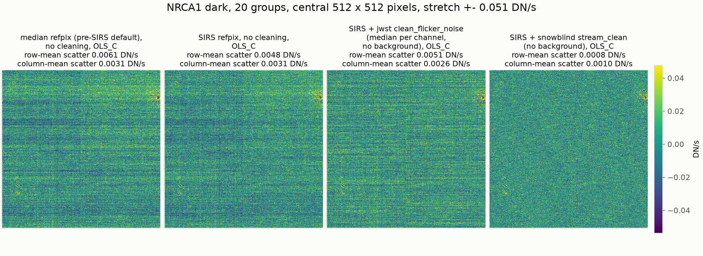
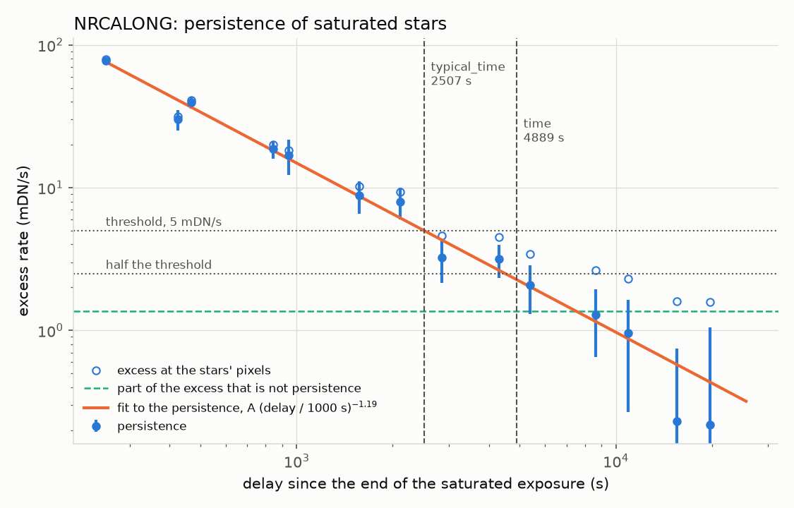

# snowblind: algorithms for cleaning JWST data

snowblind provides steps for JWST near-infrared data that improve on, or add
to, steps of the official jwst pipeline. They run like the pipeline's own
steps, on their own or as hooks inside the jwst pipelines.

Read the [documentation](https://mpi-astronomy.github.io/snowblind/) for how
each step works and how to choose its settings.

## What it provides

- **`SnowblindStep`** masks the halos of cosmic-ray showers and snowballs by
  growing the shape of each jump-flagged region and the ring around its
  saturated core. It replaces the jump step's `expand_large_events`, which
  draws circles or ellipses around them, and works on rate products as well
  as ramps, so it can be applied after the fact.
- **`JumpPlusStep`** flags, in readouts that average several frames per
  group, the group after each jump and the group before saturation, which
  the jwst jump and saturation steps leave unflagged. It replaces the jump
  step's `after_jump_flag` settings.
- **`PersistenceFlagStep`** flags the pixels that saturated in an earlier
  exposure of the same detector, for a time measured for each detector and
  packaged with snowblind. The jwst `persistence` step (as of jwst 3.0)
  needs a time chosen by hand and the exposures run one after another; this
  step takes a whole set of finished `_rate` or `_cal` files at once.
- **`OpenPixelStep`** finds open and hot pixels that have appeared since the
  reference bad-pixel mask was made, by comparing the exposures of each
  detector. Experimental.
- **`StreamCleanStep`** removes 1/f noise (striping) from the ramp along
  each output channel's readout stream. Unlike the jwst
  `clean_flicker_noise` step, it applies the same linear filter to every
  group difference, so it adds no noise along the ramp and does better the
  more groups there are.
- **`ResetRampFitStep`** is the jwst likelihood ramp fit with the reset
  level as an extra point at the start, so pixels with only one unsaturated
  group, such as the cores of bright stars, still get a rate.
- **`snowblind_detector1`** is `calwebb_detector1` with the stream clean,
  the reset likelihood ramp fit and the snowball and jump steps in place,
  and the SIRS reference-pixel correction. It works as a drop-in
  replacement.
- **`SparseResampleStep`** and **`SparseOutlierDetectionStep`** are the jwst
  resample and outlier detection steps for images with drizzle replaced by
  [spizzle](https://github.com/mpi-astronomy/spizzle). The mosaic's
  variance planes are the exact variance of each pixel, and a noise factor
  image gives what the correlation between neighboring pixels adds to the
  noise of a sum over them; both steps are faster than the jwst steps.
- **`TiledOutlierStep`** finds outliers against one reference built from
  the input pixels of all the exposures at once, on a grid finer than the
  pixels, so it resolves undersampled star cores: it finds more cosmic rays
  near stars and flags far fewer star cores than the jwst step, with the
  same settings for every filter, and never allocates a mosaic-sized array.
- **`snowblind_image3`** is `calwebb_image3` with `TiledOutlierStep` and
  `SparseResampleStep` in place (`--tiled_outliers=False` uses
  `SparseOutlierDetectionStep` for the outliers).

## Installation

    pip install snowblind

snowblind needs jwst 2.0.0 or later; earlier releases of snowblind work with
earlier jwst releases. The resampling and outlier detection steps need
spizzle as well:

    pip install 'snowblind[spizzle]'

## Getting started

Run Detector1 with the 1/f cleaning, the reset fit and the snowball masking
(and the SIRS reference-pixel correction, which the 1/f cleaning is matched
to):

    strun snowblind_detector1 jw..._uncal.fits

Or add only the snowball and jump steps to the jwst pipeline, as hooks after
its jump step:

```python
from jwst.pipeline import Detector1Pipeline
from snowblind import JumpPlusStep, SnowblindStep

steps = {"jump": {"expand_large_events": False, "post_hooks": [SnowblindStep, JumpPlusStep]}}
Detector1Pipeline.call("jw..._uncal.fits", steps=steps, save_results=True)
```

Flag persistence in a set of `_cal` files, after `calwebb_image2`:

```python
from glob import glob
from snowblind import PersistenceFlagStep

PersistenceFlagStep.call(sorted(glob("jw*_cal.fits")), save_results=True, suffix="cal", output_dir="persist")
```

This writes each file again in `persist/`, with `DO_NOT_USE` and
`PERSISTENCE` set where an earlier exposure of the same detector saturated
recently.

Run Image3 with the snowblind outlier detection and resampling, which saves
the noise factor as `<product>_nfactor.fits` next to the `_i2d.fits` mosaic:

    strun snowblind_image3 jw..._image3_asn.json

## Results

`StreamCleanStep` on a dark exposure, against no cleaning and the jwst
`clean_flicker_noise` step:



The persistence of saturated stars against the time since their exposure
ended, which sets the time `PersistenceFlagStep` flags them for:



## Citing snowblind

Please cite `snowblind` through its Zenodo record DOI,
[10.5281/zenodo.15791614](https://doi.org/10.5281/zenodo.15791614), that
always points to the latest release.

    @software{snowblind,
      author    = {Davies, James E.},
      title     = {snowblind: algorithms for cleaning JWST data},
      publisher = {Zenodo},
      doi       = {10.5281/zenodo.15791614},
      url       = {https://github.com/mpi-astronomy/snowblind}
    }

The same information is in `CITATION.cff`.

Please open an issue if you have any problems!
