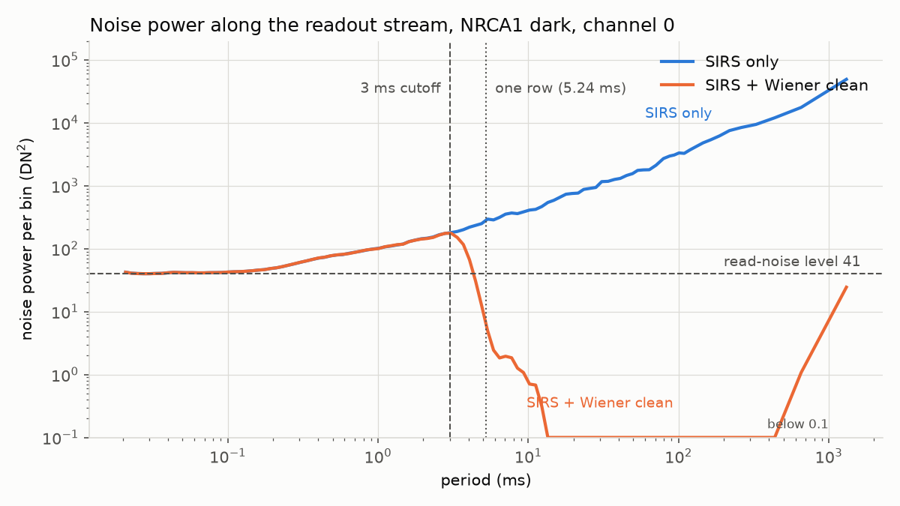
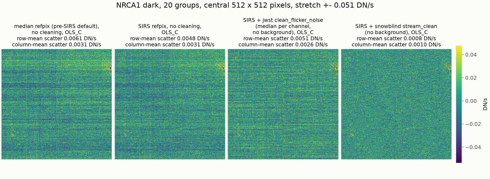
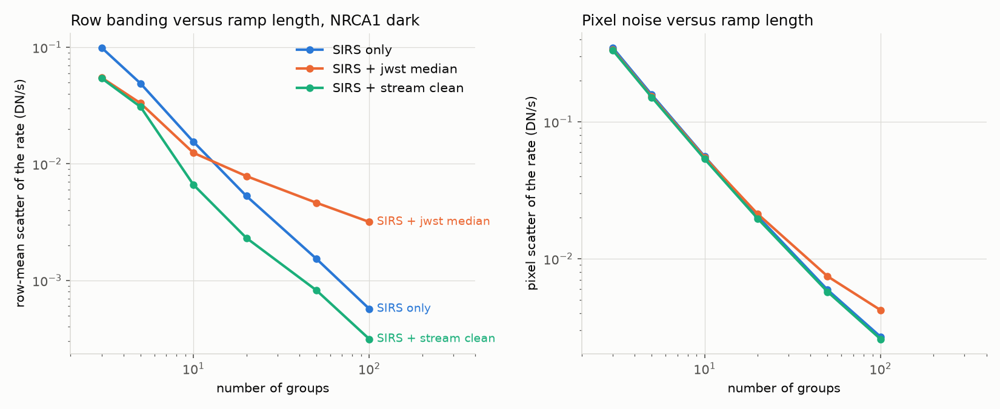
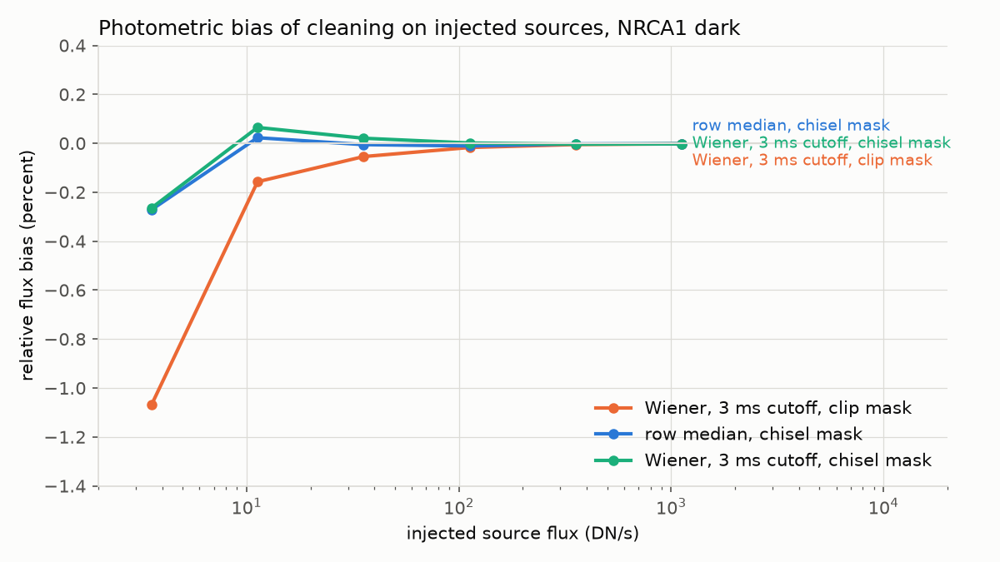
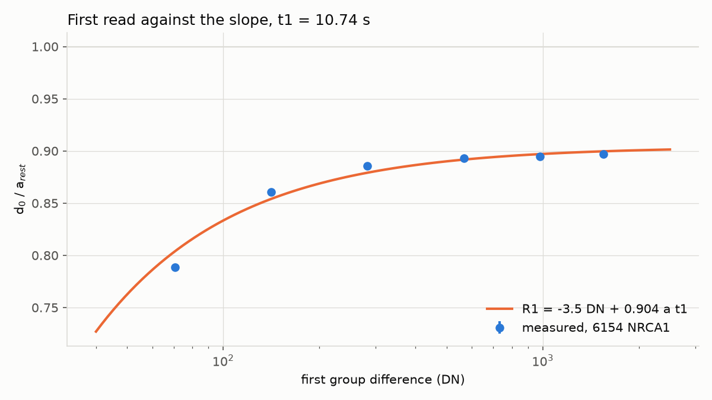

1/f cleaning along the readout stream and reset-anchored ramp fitting
=====================================================================

This page describes the two group-level steps of snowblind for NIRCam and
NIRISS: ``StreamCleanStep`` (``stream_clean``), which removes 1/f
(flicker) noise from the ramp, and ``ResetRampFitStep``
(``reset_rampfit``), which fits the ramp with the reset level as an extra
point. It covers what data they take, how to run them, how to choose
their settings, how they work and where they are limited. The
measurements behind the defaults, on darks and on a range of public
imaging and WFSS fields, are recorded in the dated entries of
``PLAN-1f-cleaning-and-reset-anchored-rampfit.md`` (section D) in the
repository, and the scripts under ``scripts/`` regenerate them.

Summary
-------

* ``StreamCleanStep`` removes 1/f noise from the group differences of a
  ramp by filtering each output channel's readout-ordered sample stream
  with a Wiener gain derived from the exposure's own masked background.
  The same linear operation is applied to every difference, so, unlike
  per-difference medians, it adds no noise along the ramp, and it does
  better the more groups there are. It also removes the per-read
  even-odd column offsets and a per-column offset that drifts during the
  integration.
* ``ResetRampFitStep`` runs the stcal likelihood ramp fit with the
  superbias-subtracted reset level prepended as an extra resultant, with
  its own calibrated uncertainty and timing, so that pixels with a single
  unsaturated group, or only a usable zeroframe, still get a rate. Its
  main use is the cores of bright stars that saturate after the first
  group; elsewhere it agrees with the likelihood fit without the reset
  point.

Both work on group data after the jump step and want the reference-pixel
step run with the SIRS algorithm, which ``snowblind_detector1`` does; in the
jwst pipeline, whose reference-pixel step defaults to a running median, give
``--steps.refpix.refpix_algorithm=sirs``.
The stream clean takes full-frame NIRCam and NIRISS exposures and marks
anything else SKIPPED. The reset fit needs a calibration of the detector's
reset level; one is packaged for each of the ten NIRCam detectors and for
NIRISS, and ``snowblind-reset-calib`` makes one from dark ramps.

Running the steps
-----------------

The ``snowblind_detector1`` pipeline is ``calwebb_detector1`` with its
steps, parameters and CRDS parameter references, except that
``StreamCleanStep`` runs as a post-hook of the jump step (the pipeline's
own ``clean_flicker_noise`` step is skipped, since some parameter
references turn it on), ``ResetRampFitStep`` takes the ``ramp_fit`` slot,
the superbias step is a subclass of the jwst one (see `Unusable zeroframe
pixels`_), and the reference-pixel step uses SIRS, whose output the stream
clean is matched to (``--steps.refpix.refpix_algorithm=median`` gives the
jwst default back). One run gives the ``_rate`` and ``_rateints`` products
of the cleaned ramp and the reset-anchored fit::

    strun snowblind_detector1 jw..._uncal.fits

or, in Python:

.. code-block:: python

    from snowblind import Detector1Pipeline

    Detector1Pipeline.call("jw..._uncal.fits", save_results=True)

The pipeline also sets up the jump step for the two. It runs at 7 sigma
(the three- and four-group thresholds too), flags the four neighbors of
jumps above 20 sigma, and leaves the snowball expansion to
``SnowblindStep(min_radius=3, after_jumps=5)`` as its first post-hook; its
flagging of the groups after large jumps (``after_jump_flag_*``) stays as
the jwst step and CRDS set it. At
7 sigma the jump step flags what would disturb the stream clean, and the
reset fit's own jump search (4.5 sigma) finds the fainter jumps on the
cleaned ramp; a clean with no jump flags at all leaves more striping in the
rate image, and 7 sigma cleans as well as 5 sigma. These settings take
precedence over the CRDS parameter references and give way to the caller's
(``--steps.jump.rejection_threshold=5``);
``--steps.jump.expand_large_events=True`` gives back the jwst snowball
flagging in place of the hook.

Parameters of the reset fit go through the ``ramp_fit`` step
(``--steps.ramp_fit.reset_calib=my_calib.asdf``), parameters of the stream
clean through the hook
(``--steps.jump.post_hooks="snowblind.StreamCleanStep(background_method='median')",``).
Either substitution switches off, ``--stream_clean=False`` or
``--reset_fit=False``, which gives the jwst step back. The jump setup stays
either way. The default algorithm of the jwst ramp fit, ``OLS_C``, does no
jump search of its own (``LIKELY`` searches at 4.5 sigma), so with
``--reset_fit=False`` give the jump step its threshold too
(``--steps.jump.rejection_threshold=4``, for example); the pipeline warns
while it is still at 7 sigma.

The stock pipeline does the same with hooks alone: the stream clean as a
post-hook of the jump step (``--steps.jump.post_hooks="snowblind.StreamCleanStep",``
with ``--steps.clean_flicker_noise.skip=True``) and the reset fit as a
post-hook of a skipped ``ramp_fit`` in its ``as_hook`` form
(``--steps.ramp_fit.skip=True
--steps.ramp_fit.post_hooks="snowblind.ResetRampFitStep(as_hook=True)",``),
which returns the rate image alone and writes the ``_rateints`` product
itself, since stpipe runs a step's post-hooks even when the step is
skipped and takes a hook's return value as the data that goes on. In
Python a hook can be the step class itself, or a step instance with any
arguments. Both steps also run on their own on a ``_jump`` product
(``strun stream_clean jw..._jump.fits``, ``strun reset_rampfit
jw..._jump.fits``).

In full, the stock pipeline with both hooks::

    strun calwebb_detector1 jw..._uncal.fits --steps.refpix.refpix_algorithm=sirs \
        --steps.jump.post_hooks="snowblind.StreamCleanStep", --steps.clean_flicker_noise.skip=True \
        --steps.ramp_fit.skip=True --steps.ramp_fit.post_hooks="snowblind.ResetRampFitStep(as_hook=True)",

On the command line a hook string carries one keyword argument at most,
since the hook list is split on commas, and the trailing comma makes a list
of one. A pre-hook of ``ramp_fit`` would also run before the skip, but the
skipped step then marks its output as skipped and the pipeline names it
``_ramp``; the post-hook form sets the ramp-fit record itself, so the
product is ``_rate``. This route keeps the jwst superbias step, so the reset
fit finds the zeroframe at 0 in up to 1% of the pixels and fits those
without it (see `Unusable zeroframe pixels`_). For the stream clean alone,
leave ``ramp_fit`` as it is::

    strun calwebb_detector1 jw..._uncal.fits --steps.refpix.refpix_algorithm=sirs \
        --steps.jump.post_hooks="snowblind.StreamCleanStep", --steps.clean_flicker_noise.skip=True

The same in Python:

.. code-block:: python

    from jwst.pipeline import Detector1Pipeline
    from snowblind import StreamCleanStep

    Detector1Pipeline.call(
        "jw..._uncal.fits",
        steps={
            "refpix": {"refpix_algorithm": "sirs"},
            "jump": {"post_hooks": [StreamCleanStep]},
            "clean_flicker_noise": {"skip": True},
        },
        save_results=True,
    )

A snowblind step run as a hook inside a jwst pipeline sends its log
messages to the pipeline's handlers, so they appear in the pipeline log
like jwst's own. At INFO level each step says in plain words what it did:
the background mask, the rms of the 1/f noise removed, how the reset
level was anchored. What the reset fit used is also kept in the
``meta.snowblind.reset_rampfit`` metadata of the ``_rate`` and
``_rateints`` products: the scatter of the reset level, the offset of the
reset level over its prior and the first-read timing in each output
channel, and where each came from (this exposure's sky or bright pixels,
or the calibration).

Choosing the settings
---------------------

The defaults are set for sky-limited imaging: a scalar background
measured on the flat-fielded difference, the two-tier scene mask with
the spikes of saturated stars followed, and the packaged reset
calibration with the reset offset anchored to each exposure's own sky.
What to change for other data:

Darks
   ``background_method=None``. The filter then removes all structure
   slower than its cutoff, which on a dark is all 1/f noise; a
   background model would hand the slow part of it back.

Sky-limited imaging (the default)
   ``background_method='median'``, one number per difference. Sparse
   fields of galaxies and stars on a smooth sky need nothing else.

Extended emission
   In one exposure, extended emission and slow 1/f noise cannot be told
   apart: both are smooth structure at scales of hundreds of pixels.
   Under a scalar background the filter removes such structure, and the
   step warns when the unmasked background under the median has that
   much of it. ``background_method='integration_model'`` keeps it: a
   box-spline background (``background_box_size``, default 32 by 32
   pixels) fitted to the integration's least-squares slope image and
   scaled to every difference. It keeps whatever it holds above the box
   scale, the 1/f noise there included, so a larger box removes more
   noise and keeps less of the emission. Use it for nebulosity, nearby
   galaxies and the extended halos of bright stars that must be kept. A
   ``scene_model``, a FITS image of the scene in DN/s in the detector
   frame before flat-fielding (for example a mosaic of the other dithers
   blotted back to the exposure), replaces the background model; it
   helps only where it is more accurate than the 1/f being removed, as
   for smooth emission in a sparse field.

Crowded fields and bright stars
   The scene mask cannot cover all the wings of the stars in a crowded
   field, and a linear estimator reads unmasked wings as slow 1/f and
   subtracts them along the row: short dark streaks along the rows next
   to the brightest stars, and a sky lowered by up to a few percent where
   the mask covers little. ``fit_method='row_median'`` is less sensitive
   to wings at the cost of some banding left in; ``mask_dilation`` grows
   the masked regions into the wings.

Dispersed (WFSS) exposures
   The step switches itself to ``background_method='crds_background'``
   and, unless ``column_offsets`` and ``even_odd_columns`` are set, turns
   them off where the traces run along the columns (NIRISS GR150C, NIRCam
   GRISMC); see `Dispersed exposures`_. Grisms that disperse along the
   readout stream (NIRISS GR150R, NIRCam GRISMR) get no stream filter
   (``fit_method='auto'`` is ``'none'`` there, only the offsets) unless
   ``fit_method`` names ``'wiener'`` or ``'row_median'``.

Detectors or epochs the packaged calibration does not cover
   Measure your own reset calibration from dark ramps of the detector
   with ``snowblind-reset-calib`` and give it to the reset fit
   (``reset_calib``): ``snowblind-reset-calib jw..._nrca1_uncal.fits -o
   nrca1_reset_calib.asdf``, then ``strun reset_rampfit jw..._nrca1_jump.fits
   --reset_calib=nrca1_reset_calib.asdf``. The file also carries the detector's mean reset
   level per pixel, which ``use_pedestal_mean=True`` uses as the prior;
   give the same file to the stream clean (``reset_calib``) so that the
   first read is cleaned against the same prior.

Exposures with many bright unsaturated pixels
   ``anchor_timing_to_stars=True`` fits the first-read timing per
   channel from the exposure itself instead of taking it from the
   calibration.

How the stream clean works
--------------------------

Readout geometry
~~~~~~~~~~~~~~~~

In the detector frame rows are the slow axis; the four outputs are
512-column blocks, and adjacent outputs read in opposite directions. Each
output reads one pixel every 10 microseconds (the pixel time, the unit of
the stream), and 12 pixel times of overhead separate the end of one row
from the start of the next, so a full-frame row takes 524 pixel times,
5.24 ms. Channel 0 reads toward increasing detector column
(``first_direction=1``), which was checked on darks of NIRCam short- and
long-wavelength detectors and of NIRISS through the correlation of
samples that straddle a row boundary. NIRCam reads along science rows and
NIRISS along science columns, so on NIRISS the banding is vertical and
the outputs are horizontal bands of the science frame.

The noise
~~~~~~~~~

Along the readout stream the spectrum of a group difference is flat at
the read-noise level at short periods and rises as a power law of slope
close to 1 toward long periods; the two cross at periods of about a
millisecond, a fifth of a row. Most of the 1/f power is at periods of a
row and longer, which is the row banding of the rate image (column
banding on NIRISS). Inter-pixel capacitance correlates neighboring
samples, and there are weak pickup lines at periods of a few pixels. SIRS
removes the part of the 1/f that the reference pixels can see; the stream
clean removes what is left, within and between the output channels.

   What the cleaner removes, on one output channel of a NIRCam
   short-wavelength dark. Each curve is the noise power in a group
   difference against the period along the readout stream, on log axes,
   median over the differences and over logarithmic period bins. Before
   cleaning (blue) the power is flat at the read-noise level at periods
   below 0.3 ms and rises as 1/f toward long periods, by a factor of
   about 30 at one row (5.24 ms) and 1000 at a second. After the clean
   (orange) the power at every period longer than the 3 ms cutoff is two
   to four orders of magnitude below the read-noise level: the row
   banding and everything slower is removed. Below the cutoff the two
   curves coincide by construction.

Why cleaning group differences can add noise
~~~~~~~~~~~~~~~~~~~~~~~~~~~~~~~~~~~~~~~~~~~~

A step that estimates the 1/f noise in each group difference, subtracts
it and rebuilds the groups makes cleaned group j the input group j minus
the sum of the estimates of differences 1 to j. The true 1/f offsets do
not accumulate in that sum: the offset of a read enters two neighboring
differences with opposite signs, so only the first and last survive. An
estimate does the same only if it is a fixed linear function of the
data, applied identically to every difference; a mean over the same
pixels in every difference collapses in the sum to the mean of group j
minus that of group 0. Anything else becomes a random walk along the
ramp. For a per-row median it is the difference between a median and a
mean, new in every difference; a background model fitted to each
difference separately, or per-difference sigma clipping, which changes
the pixels used from one difference to the next, add more. The slope fit
weights that walk heavily (about 27 times more in variance than the true
offsets for a 20-group ramp), and more so the more groups there are, so
such a clean can leave the rate image noisier than no clean at all while
every group difference looks cleaner.

The stream clean therefore makes every choice once per integration: the
scene mask, the background model (fitted to the least-squares slope
image and scaled to each difference by its time) and the filter are the
same for every difference, and the even-odd and column offsets are masked
means. The whole clean is one linear operation on the ramp and cannot
add noise to the rate.

   The central 512 by 512 pixels of the rate image of a 20-group NIRCam
   short-wavelength dark, fitted with OLS_C, after the median
   reference-pixel correction, SIRS, SIRS with the jwst
   ``clean_flicker_noise`` step (median method) and SIRS with the stream
   clean, both cleaning steps with no background model, as is right on a
   dark. Stretch +- 2.5 sigma about the median. The jwst step removes the
   banding from every group difference, yet the rate image keeps about as
   much row structure as with SIRS alone: over 20 groups the
   per-difference medians accumulate into as much as they removed. The
   stream clean leaves the read noise, and its even-odd and column offset
   corrections take out the column-to-column structure.

   Row-mean scatter and pixel scatter of the OLS_C rate image against the
   number of groups fitted, on the same dark, for SIRS alone, SIRS with
   the jwst median step and SIRS with the stream clean. The jwst step
   halves the banding at 3 groups, crosses SIRS at about 12 groups and is
   5 times worse at 100, which is the turnover the JWST documentation on
   1/f noise reports for ``clean_flicker_noise``. The stream clean stays
   below SIRS by about a factor of 2 at every length.

The filter
~~~~~~~~~~

For each output channel the step takes the stream of the difference with
the background model subtracted, leaves out the masked samples, and
estimates the noise autocorrelation out to ``max_lag`` pixel times
(65536, 0.66 s). From it comes the Wiener gain: at each period, the share
of the power that is 1/f noise rather than the white floor. The gain is
zero at periods shorter than ``min_period``, 300 pixel times (3 ms, about
half a row), so the filter leaves alone anything that changes within a
few hundred pixels along the stream, such as compact sources and the
cores and near wings of stars; without the cutoff, injected faint
sources lost about 12 percent of their flux. The masked samples are
bridged from the samples either side, and where the local fraction of
background pixels is below ``min_density`` (0.2) the estimate tapers off.
``anchor_mean`` (on by default) sets each channel's mean removed noise to
the masked mean of the residual, so a robust estimator such as
``fit_method='row_median'`` cannot shift the sky. What the step did to
the sky level is recorded in ``meta.snowblind.stream_clean`` of the ASDF
extension, in DN/s of the flat-fielded sky and averaged over the group
differences and integrations: ``sky_mean_minus_median``, the masked mean
minus the masked median of the background pixels (the shift a scalar
median background imposes), and ``sky_change_by_cleaning``, the change of
the sky made by the cleaning, negative when lowered. Both are also in
the primary header, as ``SKYMNMED`` and ``SKYCHG``, and their values for
each integration are in ``sky_mean_minus_median_per_integration`` and
``sky_change_by_cleaning_per_integration``. The reset fit carries them to
the rate file, and calwebb_image2 keeps them in the ``_cal`` files.

The background model
~~~~~~~~~~~~~~~~~~~~

The step subtracts a background model from each difference before it
estimates the noise and adds it back afterwards. Since the gain is 1 at
the longest periods, structure at scales above a few rows that the model
does not hold is removed as noise, and whatever the model holds is kept,
including any 1/f noise it has fitted; this is why the right model
depends on the data (see `Choosing the settings`_). The background of a
sky field is the sky times the detector response, while the 1/f noise is
additive in raw DN, so the step measures the background on the
flat-fielded difference and subtracts that background times the flat
from the raw difference (``apply_flat_field``). Without this the response
pattern of the long-wavelength detectors, about 10 percent at large
scales, would be read as noise. The box model is the masked mean per
box, which cannot bias the sky; a clipped median per box sat well below
the masked mean on crowded fields, and the filter removed the
difference.

The scene mask
~~~~~~~~~~~~~~

A low-pass filter removes part of any source that the mask misses, so the
mask matters. The step builds it on the draft rate image along the lines
of NoiseChisel (Akhlaghi and Ichikawa 2015). The draft rate is destriped
with row and column medians that leave out pixels more than 3 sigma from
zero, sky-subtracted with a tiled sky model and convolved with a 2-pixel
Gaussian; pixels above the median of the result are candidates; two
erosions and an opening remove what noise alone produces; each surviving
region must exceed the 99th percentile of the signal-to-noise of the
false detections that the same procedure finds in the sign-flipped
image; and the survivors are grown back over the eroded border and into
pixels above the 0.9 quantile. A second, coarse tier (a 12-pixel kernel
on a 256-pixel tiled sky, with a higher detection quantile) masks the
inner halos of bright stars, which the fine tier's 32-pixel sky absorbs.

The mask also follows the diffraction spikes of saturated stars along
both image axes, outward in blocks against the local background on
either side until they fade (``mask_spikes``): a spike that runs past
the mask would bias the column (or row) offsets of the columns through
the star. It leaves out every pixel the DQ marks DO_NOT_USE in the mask
reference, the flat reference and the group flags; the flat's own DQ
matters where it is the only one that marks a defect, such as the
occulting spots of NIRISS. ``mask_dilation`` grows the masked regions and
``user_mask`` replaces the mask.

   Relative bias of the aperture flux (radius 3 pixels) of 1500 Gaussian
   sources injected into a NIRCam dark with a structured sky, against
   their flux, all with the 3 ms cutoff. With a per-pixel sigma-clip
   mask like the jwst step's, the Wiener clean loses 1 percent of the
   faintest sources (2 to 6 DN/s); with the NoiseChisel-style mask both
   the Wiener clean and a row median lose 0.3 percent there, and nothing
   above 6 DN/s.

Even-odd and column offsets
~~~~~~~~~~~~~~~~~~~~~~~~~~~

Each amplifier gives its even and odd columns a slightly different offset
in every read, a few hundredths of a DN with a different value from one
integration to the next, so the superbias cannot remove it. The step
measures it per amplifier and per difference from the masked science
pixels and subtracts it before the filter (``even_odd_columns``).

Each column also carries an offset that drifts during the integration,
white across columns and independent per amplifier. The stream filter
cannot see it, since it repeats once per row, inside the band the filter
leaves to the scene. The step removes each column's masked mean from each
difference, per amplifier, after the background model and before the
filter (``column_offsets``). This is the column pass of masked striping
removal moved into the ramp: the slope is a fixed linear combination of
the differences, so a mean per difference equals subtracting the column
mean of the rate image and cannot add noise, where a median would
random-walk. Row banding does not bias the column means, since it adds
the same value to every column of a row. On NIRISS the same correction
runs along science rows. Both offsets are off on WFSS exposures whose
traces run along the columns; see `Dispersed exposures`_.

The first read and the zeroframe
~~~~~~~~~~~~~~~~~~~~~~~~~~~~~~~~

For OLS_C the first read's own banding is common to every rebuilt group
and drops out of the slope. The reset-anchored fit uses group 1 minus the
reset prior as a difference of its own, so that banding would enter its
rate. The step therefore also cleans group 1 (``clean_first_group``, on
by default), against zero or, given the reset calibration file
(``reset_calib``), against the reset prior the reset fit will use: the
pedestal map with its row, even-odd and column structure removed, plus
the channel offsets. The filter then sees only the 1/f noise of the reset
frame and the first read. For frame-averaged readouts the pipeline keeps
the first frame of the first group separately as the ZEROFRAME, which the
likelihood fit uses as a resultant of its own; the step cleans it in the
same way, with the background scaled to one frame time.

How the reset-anchored fit works
--------------------------------

The reset point
~~~~~~~~~~~~~~~

Every ramp starts at the reset level. After the superbias is subtracted
that level is zero on average, with a scatter ``sigma_b`` per pixel and
integration: 15 to 21 DN on the NIRCam detectors (about 35 electrons,
the size of the kTC noise of the reset) and 25 DN on NIRISS. The step
prepends it to the stcal likelihood fit as an extra resultant at the
reset time, with variance ``sigma_b**2``; the rest of the fit is
unchanged. A pixel with a single unsaturated group then has two points,
the reset and the group, and gets a rate, and so does a pixel with only
a usable zeroframe. In a 5-group ramp the reset difference carries about
1/23 of the weight of an ordinary difference, so it changes little
where several groups are usable and matters where few are, chiefly in
the cores of bright stars that saturate after the first group. Pixels
with exactly two usable differences are guarded in the jump search,
which is degenerate there.

The packaged calibration holds ``sigma_b`` per detector, measured from
the pedestals of OLS_C fits to dark integrations after removing the first
group's own read noise, and the first-read timing below. ``sigma_b``
overrides it with a scalar.

The first-read timing
~~~~~~~~~~~~~~~~~~~~~

The first read holds less signal than the slope predicts. Its signal
follows ``b + k a t1``, where ``a`` is the rate and ``t1`` the time of the
first group, with ``k`` between 0.88 and 0.95 at a first-group time of
10.7 s on the ten NIRCam detectors and NIRISS: as if the integration
started 0.5 to 1.3 s after the nominal reset. The four channels of a
detector agree to a few hundredths in ``k``, and the offset ``b`` is a
few DN. The
fit models ``k`` as a reset delayed by ``(1 - k) t1``, which leaves every
later interval unchanged; scaling the first group's read time instead
would also stretch the first ordinary interval and bias the rates. For
another readout pattern the delay carries over as a fixed time. Without
the correction the reset-anchored fit would shift the median rate of all
pixels by about 1 percent. ``t1_scale`` sets ``k`` for an exposure, and
``per_channel_timing`` (on by default) uses the calibration's values per
channel.

   Ratio of the reset difference to the rate from the other differences
   against the first group difference, on a NIRCam short-wavelength
   field, with the two-parameter model. The form is the same on every
   detector measured; only ``k`` and ``b`` change, and they are in the
   packaged calibration of each detector.

The reset offset
~~~~~~~~~~~~~~~~

The mean reset level drifts relative to the superbias, by 10 DN and more
over months, so the prior mean cannot be a calibration constant. The
step measures it per output channel from the exposure's own sky
(``anchor_offset_to_sky``, on by default): the pixels whose
first-resultant signal is below ``anchor_max_signal`` (50 DN), when a
channel has at least ``anchor_min_pixels`` (1000) of them; otherwise the
calibration's offset is kept. This centers the first-difference residual,
and the reset fit then agrees with the likelihood fit without the reset
point to about 0.1 percent at every brightness. ``reset_offset`` adds a
fixed number of DN on top.

The pedestal map and the superbias
~~~~~~~~~~~~~~~~~~~~~~~~~~~~~~~~~~

The calibration file also holds the detector's mean reset level per
pixel, measured on darks after their CRDS superbias was subtracted, so it
is a residual against that superbias. With ``use_pedestal_mean`` it
becomes the prior mean, with its row, even-odd and column structure
removed (``prior_highpass``) as the stream clean removes them from the
first read. The file records the superbias the darks were processed
with, and the step reads the name the superbias step wrote into the
data. When the two differ, the prior is corrected by the difference of
the two reference images. The step also declares ``superbias`` among its
reference types, so CRDS delivers the best reference for the data, and
it says so when that differs from the one the data had subtracted.

Unusable zeroframe pixels
~~~~~~~~~~~~~~~~~~~~~~~~~

The ZEROFRAME has no DQ array, so the pipeline marks an unusable
zeroframe pixel (saturated, or at the A/D floor) by setting it to 0, and
the later steps leave zeros alone: the reference-pixel step, linearity
and the stream clean do not correct them, and ramp fitting does not use
them. The jwst superbias step keeps the zeros it is given, but a pixel
whose raw zeroframe equals the superbias exactly also comes out at 0.
The raw data are whole DN, so this happens wherever the superbias value
is a whole number and the raw zeroframe equals it. With superbias
references that hold only whole and half-integer values, as recent
NIRCam references do, that is typically a few tenths of a percent of the
pixels, up to about 1 percent when the bias level sits close to the
superbias.

The superbias step of ``snowblind_detector1``, a subclass of the jwst
one, notes the zeros it is given and sets any other zeroframe pixel left
at 0 to the smallest normal float32, which is 0 DN to every later step
but not the marker, so those pixels keep the reference-pixel correction
and the reset fit uses their zeroframe. The reset fit itself treats a
zero zeroframe as unusable (DO_NOT_USE in its zeroframe plane, so the
rate DQ does not mark it SATURATED) and fits those pixels again without
the zeroframe, so with the jwst superbias step, as in the stock-pipeline
hook recipe, they lose only their zeroframe. The stcal likelihood fit
takes a zero zeroframe as data, which biases those pixels' rates and can
flag false jumps; OLS_C uses the zeroframe only for pixels without a good
group and skips zeros.

Jumps
~~~~~

The likelihood fit searches for jumps on top of the jump step's flags
(``rejection_threshold``, 4.5 sigma by default) and logs the pixels in
which it found jumps the jump step had not flagged. A lower threshold for
this search (4 sigma) made more false jumps than it caught real ones: a
false jump splits a ramp into two segments, and where read noise
dominates a split in the middle nearly doubles the pixel's noise.

Dispersed exposures
-------------------

A WFSS exposure carries the dispersed zodiacal and stray light as a
smooth background that varies along the dispersion, by a factor of a few
across the frame. A scalar background hands that gradient to the filter,
which removes it, and a box-spline background keeps the gradient but
gives back the banding. On a WFSS exposure the step therefore defaults to
``background_method='crds_background'``: it takes the CRDS background
reference for the grism and filter, scales it once to the exposure by the
median ratio to the ramp's own slope image over the masked background
pixels, and subtracts it from every group difference scaled only by its
time, so nothing is fitted per difference. The scene mask is then built
on the residual, where the traces stand against a flat sky.

The references are not all in the same units. The NIRISS ones carry the
detector's pixel response; the NIRCam ones are flat-fielded. Neither the
files nor their documentation say which, so the step tells them apart
from the correlation of the reference's pixel-scale structure with the
flat's (about 0.8 to 1 for raw, near 0 for flat-fielded), logs it, warns
when it is between 0.3 and 0.7, and multiplies a flat-fielded reference
by the flat before scaling. ``reference_units`` decides by hand.

Three more changes keep dispersed sources out of the noise estimate:

* ``column_offsets`` and ``even_odd_columns`` are turned off, unless they
  are set to ``True`` (the default, ``None``, is on for imaging and for
  grisms that disperse along the stream, off for those whose traces run
  along the columns). A trace covers hundreds to over a
  thousand pixels of a column, and the outskirts of the detected traces
  and the whole of the undetected ones raise the masked mean of their
  columns, so removing it takes flux out of every trace in the column (a
  few to 30 percent on faint traces). No other estimator avoids that,
  since the column structure is itself smooth over tens of columns. The
  even-odd offset is one number per amplifier, so a trace moves it far
  less, but it is measured the same way and follows the same rule. Where
  the traces run along the stream instead (NIRISS GR150R, NIRCam GRISMR),
  a trace crosses a few pixels of each column and both offsets are safe;
  a generous ``mask_dilation`` keeps the unmasked wings of the traces from
  pulling up the column means.
* The scene mask destripes only along the readout stream's axis, so a
  long trace does not set its column's median.
* The Wiener gain is notched at the row frequency of the readout (a
  Gaussian 2 percent wide), where the unmasked wings of traces along the
  columns, at the same clock in every row, would otherwise pass as noise.

With these, the change the clean makes in the trace pixels equals the
change in the sky pixels of the same row, within the measurement's
scatter, so an extraction whose local background comes from the columns
beside a trace is unaffected.

This holds for grisms that disperse across the readout stream, NIRISS
GR150C and NIRCam GRISMC. NIRISS GR150R and NIRCam GRISMR disperse along
the stream, where a trace is a feature of a few hundred to over a
thousand pixel times, with its continuum shape and emission lines at the
scales the filter treats as noise. Faint traces and trace wings under the
mask's threshold would lose their spectral shape, a bias no sky
statistic shows, so ``fit_method='auto'``, the default, is ``'none'`` on
those exposures: no stream filter, only the even-odd and column offsets, so
the 1/f noise stays in the data. Naming ``'wiener'`` or ``'row_median'``
runs that filter at that risk, with a warning. (``allow_dispersion_along_stream``,
which used to do this, is deprecated and will be removed.) The decision is
made from the filter and pupil keywords.

Where the reference does not match the shape of the sky along the
dispersion, the residual gradient runs across the stream and the filter
removes it as slow noise; the same goes for scattered light that the
reference does not hold. The traces are unaffected, as above, but the
background level of the cleaned rate is then that of the reference.

Limitations
-----------

* One exposure cannot tell extended emission from slow 1/f noise. The
  box background keeps structure above its box at the cost of the slow
  1/f; a ``scene_model`` from the other dithers is the way to do better,
  but a mosaic of an undersampled, crowded field from a few dithers was
  not accurate enough at the slow scales to help.
* The wings of bright stars that the mask misses are partly removed as
  slow 1/f, leaving short dark streaks along the rows next to the
  brightest stars of crowded fields. A smooth halo of a few percent of
  the sky beyond about 100 pixels from a bright star is removed as well,
  as by any method that works on one exposure.
* The faintest compact sources lose a few tenths of a percent of their
  flux. Extended-source photometry has not been tested.
* The stream clean takes full-frame NIRCam and NIRISS data only.
* On faint, short ramps the likelihood fit, with or without the reset
  point, can differ from OLS_C by a few tenths of a percent on the sky,
  and on frame-averaged ramps where most groups are flagged by more per
  pixel. This is a property of the likelihood fit, not of the reset
  point; which is right at low signal needs a test with a known rate.
* The pixel-to-pixel spread of the first-read timing has not been
  measured; the calibration holds one value per channel.

What this builds on
-------------------

* The reference-pixel correction is SIRS, Simple Improved Reference
  Subtraction (Rauscher, Fixsen and Mosby 2022, JATIS 8, 028002,
  doi:10.1117/1.JATIS.8.2.028002), which ``snowblind_detector1`` uses (the
  jwst reference-pixel step defaults to a running median).
  ``stream_clean`` removes what SIRS leaves: the 1/f within and between
  the output channels that the reference pixels cannot see, and the
  per-read even-odd and column offsets.
* The idea of cleaning rows and columns after masking the sources is the
  CEERS team's (Bagley et al. 2023, ApJL 946, L12,
  doi:10.3847/2041-8213/acbb08), who subtract masked row medians per
  amplifier and masked column medians from the rate images. The column
  offsets above are that method's column pass moved into the ramp as a
  mean, so that it stays linear.
* The jwst ``clean_flicker_noise`` step descends from Chris Willott's
  image1overf for its median method and from NSClean for its Fourier
  method, which is also the closest relative of the Wiener clean.
  image1overf is software without a paper of its own: Willott, C.,
  ``image1overf.py`` in https://github.com/chriswillott/jwst (GPL-3.0),
  described on the STScI page on NIRCam 1/f noise removal methods
  (https://jwst-docs.stsci.edu/known-issues/nircam-known-issues/nircam-1-f-noise-removal-methods).
  NSClean is Rauscher 2024, PASP 136, 015001,
  doi:10.1088/1538-3873/ad1b36.
* The ramp fit is Timothy Brandt's likelihood method (Brandt 2024, PASP,
  doi:10.1088/1538-3873/ad38d9, and the companion jump-detection paper
  doi:10.1088/1538-3873/ad38da), as implemented in stcal as the LIKELY
  algorithm. ``reset_rampfit`` adds one resultant, the reset level with
  its own variance and timing, to that machinery.
* The scene mask follows NoiseChisel (Akhlaghi and Ichikawa 2015, ApJS
  220, 1).
