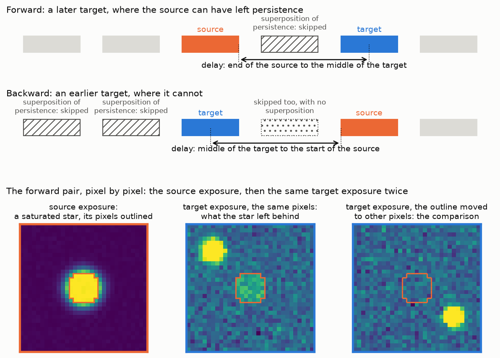
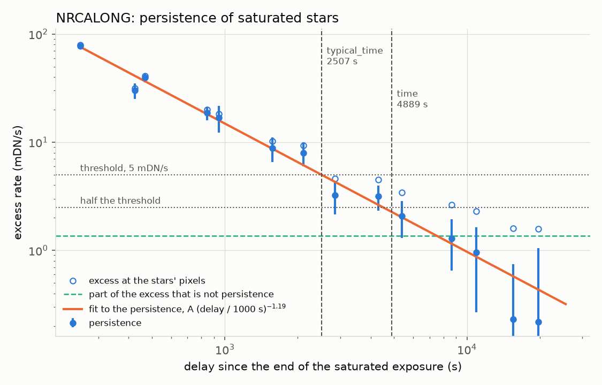

Persistence flagging
====================

A pixel that saturates traps some of its charge and releases it over the
following hours, so in the next exposures it reads high where the bright
source was, even though the telescope has moved on. ``PersistenceFlagStep``
(``persist``) flags those pixels: in each exposure, the pixels that saturated
in an earlier exposure of the same detector, for a time after that exposure
ended. This page covers how to run the step, how the time is chosen, and how
the time packaged for each detector is measured.

Summary
-------

* The step takes a whole set of exposures at once (``_rate`` or ``_cal``
  files, or an association), sorts them by detector and time, and sets
  ``DO_NOT_USE`` and ``PERSISTENCE`` in the ``dq`` array of each exposure at
  the pixels that saturated in an earlier exposure of the same detector
  which ended less than ``time`` seconds before the middle of this one. The
  science data are not changed.
* Without ``time``, each detector gets the time measured for it and
  packaged with snowblind, and 2500 s when there is none.
* The packaged times are long on purpose: they flag more than the typical
  saturated star needs, and each file also holds the shorter time of the
  typical star, ``typical_time``, for those who would rather flag less.
* It runs after the fact on existing products; nothing in Detector1 needs
  to be rerun.

Running the step
----------------

Run ``calwebb_detector1`` and ``calwebb_image2`` as usual, with the jwst
``persistence`` step skipped (its default as of jwst 3.0), then flag the
``_cal`` files of the whole set:

.. code-block:: python

    from glob import glob
    from snowblind import PersistenceFlagStep

    cal_files = sorted(glob("jw*_cal.fits"))
    PersistenceFlagStep.call(cal_files, save_results=True, suffix="cal", output_dir="persist")

This writes each ``_cal.fits`` file again, under the same name in
``persist/``. Without ``output_dir`` the files go to the current directory,
which overwrites them when they are there. With file names (or an
association file) and ``save_results``, the step reads, flags, writes and
closes one exposure at a time, keeping in memory only the saturation masks
of the last ``time`` seconds, so it handles any number of exposures; a
``ModelContainer`` is flagged in memory and returned. The step can also run
as a pre-hook of ``calwebb_image3``.

Each flagged exposure records, in its ``meta.snowblind.persist`` metadata,
the time it was flagged with (``time``, also in the header card
``PERSTIME``), where that time came from (``time_origin``: ``given``,
``packaged`` or ``default``), and how many pixels it flagged
(``flagged_pixels``) from how many earlier exposures
(``earlier_exposures``).

The saturated pixels of an exposure are those with ``SATURATED`` in its
``dq`` array; ramp fitting sets it where any group of any integration
saturated. Pixels with ``CHARGELOSS`` are flagged too: ``snowblind_detector1``
marks the pixels next to saturated ones with it, where the jwst saturation
step's default marks them ``SATURATED`` (the packaged times were measured
with that default), and its reset-anchored fit keeps it in the rate products. A
subarray exposure is placed on the detector by its subarray
start pixels, so a subarray is flagged where a full-frame exposure
saturated, and the other way round. Two files with the same start time on
the same detector are taken for the same exposure given twice and are not
flagged from each other.

Compared with the jwst persistence step
~~~~~~~~~~~~~~~~~~~~~~~~~~~~~~~~~~~~~~~~

As of jwst 3.0, the jwst ``persistence`` step is skipped by default. When it is turned on,
it flags groups of the ramp from the group in which a pixel first saturates
for ``persistence_time`` seconds, which the user has to choose; to carry the
flags into the next exposure, each run saves a file of the open flagging
windows and the next run reads it, so the exposures must be run one after
the other in time order. ``PersistenceFlagStep`` works on the finished
images of all the exposures at once, flags whole pixels rather than groups,
counts the time from the end of the saturated exposure, and comes with a
time measured for each detector.

Choosing the time
-----------------

``time`` is counted from the end of the saturated exposure to the middle of
the later one. Persistence decays from the end of the exposure that caused
it, and the rate of a later exposure is its average over that exposure,
which its value at the middle of the exposure approximates; counted this
way, an exposure longer than ``time`` still flags the next one.

The packaged files are ``snowblind/data/persistence_<detector>.asdf``. Each
holds ``time``, which the step uses, ``typical_time``, the fit and the
measurement behind them, and the provenance of the data they were measured
on:

.. code-block:: python

    from importlib.resources import files

    import asdf

    path = files("snowblind").joinpath("data", "persistence_nrcalong.asdf")
    with asdf.open(str(path)) as handle:
        print(handle.tree["time"], handle.tree["typical_time"], handle.tree["provenance"]["dataset"])

Persistence varies across a detector (with its quantum efficiency, as on
the similar Euclid NISP detectors) and with each pixel's history of
illumination: how long and how often it saturated. The measurement follows
the detector's typical saturated star, which shows neither, so ``time`` is
set for a pixel persisting twice as much as the typical star. To flag less,
pass ``typical_time``, or a time between the two, as ``time``; a time given
applies to every detector.

How the packaged times are measured
-----------------------------------

The measurement uses a long sequence of exposures of one program, taken one
detector at a time and in time order, from ``_rate`` files that have not
been flagged for persistence and are not flat-fielded. Every measurement
uses a pair of exposures: an earlier one, the *source*, and a later one of
the same detector, the *target*, which started at most 20000 s after the
source ended.

   Top: a forward pair, where the target comes after the source. Middle: a
   backward pair, where the target comes before the source (see `Measuring
   backwards`_). Hatched: the exposures whose persistence would add to the
   source's in the target, a superposition of persistence (see `One pair of
   exposures`_); their
   bright pixels are skipped when the target is measured: forward, the
   exposures between source and target; backward, the exposures before the
   target. Dotted: the exposure between target and source in the backward
   pair, skipped too because the backward pass is the forward one with time
   reversed, although its persistence cannot reach an earlier target.
   Bottom: the pixels of the forward pair, drawn schematically, framed in the colors of the exposures above: a saturated
   star in the source exposure, with its group of pixels outlined; then the
   target exposure twice, at the same detector pixels, where the star left
   an excess, and with the outline moved to unrelated pixels of the same
   exposure, where the comparison is measured.

One pair of exposures
~~~~~~~~~~~~~~~~~~~~~

* **The source's pixels, by the light they collected.** The signal of a
  pixel is its rate times the integration time, in DN. Pixels that did not
  saturate fall in classes of 2k to 5k, 5k to 10k, 10k to 20k, 20k to 30k,
  30k to 40k and 40k to 60k DN. A pixel counts as saturated when it has
  ``SATURATED`` in its ``dq`` array or more than 60k DN of signal; the
  saturated pixels fall in classes of 60k to 100k, 100k to 300k, 300k to 1M
  and over 1M DN, and "no rate" for those saturated from the first group,
  which get no rate. A pixel flagged ``SATURATED`` with less than 60k DN
  has a class of its own: mostly cosmic rays and snowballs that saturated
  partway through the ramp, and stars just at saturation. Pixels that are
  not sky (hot, warm, dead, RC and reference pixels, and so on) and their
  neighbors are left out.
* **The target's residual.** A smooth background (medians in boxes of 64
  pixels) is fitted to the target and subtracted, with the target's own
  bright pixels (saturated, or over 20k DN, grown by 4 pixels) masked, and
  the bright pixels of every exposure of the 20000 s before it, which may
  carry persistence.
* **Superposition of persistence.** A pixel that was bright (saturated, or
  over 20k DN) in an exposure between the source and the target holds that
  exposure's persistence on top of the source's, stronger for being more
  recent, which would be credited to the source at the source's longer
  delay. So the target skips those pixels, as well as its own bright and
  bad pixels, and an excess can come only from the source's light.
* **The excess of a class.** The pixels of a class in the source form
  connected groups; the core of a saturated star is one group. For each
  group, the mean residual of its pixels in the target; then the median
  over the groups. Counting groups makes each star count once, and gives
  an honest error, since the pixels of one star are not independent.
* **The comparison.** The same groups, moved by two fixed offsets to
  unrelated places in the target (keeping off the source's own classed
  pixels), measured the same way. Errors of the background, the wings of
  the target's own stars and the persistence left by other exposures
  affect a group wherever it lands; what the source left on its own pixels
  does not.
* **The value of the pair** for the class is the excess of its groups
  minus the comparison, with the delay from the end of the source to the
  middle of the target.
* **Pointing.** A pair counts only when the pointing moved by more than 100
  pixels between source and target: otherwise the source's stars are still
  on the same pixels, and the excess would be the stars, not persistence.

From pairs to a decay curve
~~~~~~~~~~~~~~~~~~~~~~~~~~~

The pairs are binned by delay, and each bin takes the median over its pairs:
a few pairs have a moved group that landed on a star of the target, which a
mean would not withstand. The error of a bin comes from resampling the
source exposures with replacement, since the pairs of one source share its
stars: half the range from the 16th to the 84th percentile of the resampled
medians.

From the curve to the time
~~~~~~~~~~~~~~~~~~~~~~~~~~

The step flags saturated pixels, so the saturated classes set the time
(without the class of saturated pixels with little signal, which persist
less). Their pairs are pooled, so a bin's median follows the typical
saturated star of the detector, and a power law, A (delay / 1000 s) to the
power -alpha, is fitted to the bins. ``typical_time`` is the delay at which
the typical star falls to 0.005 DN/s, and ``time`` the delay at which a
pixel persisting twice as much does, that is, at which the typical star
falls to 0.0025 DN/s. Each is the longer of where the fit and where the
bins cross the level, since at long delays the fit falls faster than the
data. A detector with too few bins, or no decay to fit, gets no file.

   The persistence of the saturated stars of one detector, from its
   packaged file, against the time since the end of the exposure in which
   they saturated. Open circles: the excess rate at the stars' pixels in
   later exposures, the median of each bin of delay. Dashed line: the part
   of that excess that is not persistence: it is the same at every delay,
   and is also found at the same pixels in exposures taken before the
   stars were observed (see `Measuring backwards`_). Filled circles: the
   excess less that part, which is the persistence, with the power law
   fitted to it. Dotted lines: the threshold and half of it.
   ``typical_time`` is where the typical star falls to the threshold;
   ``time``, which the step uses, is where it falls to half of it, which is
   where a pixel persisting twice as much falls to the threshold. Bins at
   or below zero are not drawn.

Measuring backwards
~~~~~~~~~~~~~~~~~~~

The comparison groups take out what affects any group in the target, but
not what sets the source's pixels apart in every exposure. The pixels of a
class were chosen for the light they collected, and near a class edge a
pixel of higher response (the rates are not flat-fielded), or with a little
unflagged dark current, is more likely to be chosen; such a pixel reads high
in every exposure, before as well as after, roughly in proportion to the
sky. The moved groups were not chosen that way, so they do not take it out.
In a sequence with a bright sky it shows as an excess of a few 0.001 DN/s
that does not decay with the delay and grows with the noise of the target.
It is clearest on faint pixels, which barely persist, and it adds to the
excess of the stars as well.

Persistence can only appear after the light, while this excess is there
before and after. So each detector is measured a second time with time
running backwards: each exposure is a source for the exposures before it,
at the same delays mirrored, from the middle of the target to the start of
the source. The source cannot have left persistence there; the selection
of its pixels is the same. The excess measured backwards does not decay, so
one level per detector and class is taken over all delays: it is the part of
the excess that is not persistence (the dashed line in the figure above),
and is subtracted from each bin of the excess measured forward, with the
errors added in quadrature.

A backward target can still hold persistence on the source's pixels from
the exposures before it: where one of them pointed where the source does (a filter change at the same dither position, for example),
its stars sit on the source's pixels. So a backward target skips, and masks
for its background, the pixels that were bright in the exposures of the
20000 s before it, as a forward target does those of the exposures between
it and the source.

Assumptions
~~~~~~~~~~~

* **Persistence decays from the end of the exposure that caused it, and a
  later rate measures it at the middle of the exposure.** The average of a
  decaying curve over an exposure is above its value at the middle, most
  for long exposures at short delays, so each bin sits slightly high for
  its delay and the times come out slightly long.
* **Each measurement follows the source's light, but not the history before
  it.** Superposition from the exposures between source and target is
  skipped; superposition from those before the source (the same star at
  the same pointing in the filter before, for example) is not, and their
  persistence adds to the source's. The curve is then higher than that of a single exposure, closer
  to what a pixel in a real sequence carries.
* **The comparison groups see everything but the persistence and the
  selection of the source's pixels**, and the backward measurement sees the
  selection but not the persistence.
* **The typical star stands for the detector.** The factor of two is there
  for the variation across the detector and between pixel histories, and
  for the dependence on how long a pixel stayed saturated: sources read
  with more groups per integration persist more.
* **One time per detector, for every saturated pixel**, however bright it
  was and however long it stayed saturated.
* **The sequence covers the delays that matter.** The delays measured
  depend on the program's cadence; a time beyond the longest delay measured
  is written with ``extrapolated`` set.

Limitations
~~~~~~~~~~~

* Pixels that persist without saturating are measured (the unsaturated
  classes) but not flagged.
* There is no map of persistence across the detector.
* The error of a bin with few source exposures is somewhat too small.

Measuring your own
~~~~~~~~~~~~~~~~~~

The two scripts are in the repository, under ``scripts/``, and need
``photutils``. ``measure_persistence.py`` measures every detector of a folder
of ``_rate`` files in both directions, one process per detector, writing a
table per detector and a summary; ``package_persistence_defaults.py`` fits
the tables and writes a file per detector::

    python scripts/measure_persistence.py --input_dir <folder of _rate files> --output_dir persistence_measurement
    python scripts/package_persistence_defaults.py persistence_measurement --dataset "<what was measured>" --out_dir my_times

The step reads only the packaged files, so pass a time from your own file
as ``time``. A useful sequence has many exposures of each detector with
saturated stars, pointings that move by more than 100 pixels, and delays
that reach past the time being measured.
