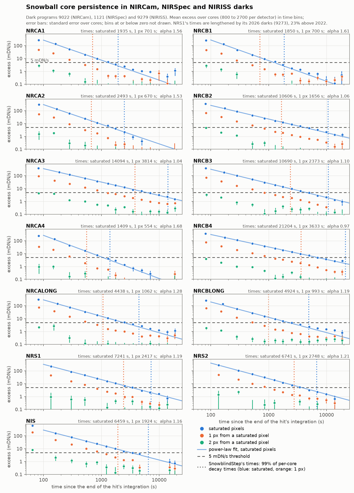

Snowball, jump and open-pixel flagging
======================================

Two steps add flags to the data quality arrays and leave the science data
alone: ``SnowblindStep`` (``snowblind``) masks the halos of snowballs, and
``OpenPixelStep`` (``open_pixel``) finds open and
hot pixels that are not in the reference bad-pixel mask. A third,
``JumpPlusStep`` (``jump_plus``), is deprecated. Persistence has a page of
its own, :doc:`persistence`.

SnowblindStep
-------------

A snowball is a saturated core inside a halo of pixels that the jump step
flags. The halo reaches beyond the flagged pixels, and the saturated core
keeps affecting the following groups. ``SnowblindStep`` takes each
contiguous region of jump-flagged pixels, with its holes filled, that holds
a core and contains a disk of ``min_radius`` pixels, and grows it by
``growth_factor`` times its equal-area radius, so the mask follows the
actual shape of the event; the core grown by ``ring_width`` pixels, the
ring, is flagged from the jump group to the end of the integration. In a
ramp the core is the pixels that saturate in the jump group or the next; a
rate image or rateints cube does not record when a pixel saturated, so
there it is the pixels flagged SATURATED. Holes of up to 200 pixels are
filled, and larger ones only when they are made of saturated pixels and the
pixels next to them, a large core: a larger hole that also holds other
pixels is sky, such as the area around a saturated star in a rate image.
In a ramp the core persists after the
reset, and is flagged in the later integrations of the exposure for a time
measured for each detector (see `The charge leak ring and the persistence
of the core`_). Large jump regions without a core, such as
cosmic-ray tracks, are left as the jump step flagged them. The jwst jump
step's own snowball flagging (``expand_large_events``) also looks for a
saturated core, and draws enclosing circles or ellipses. The default
``min_radius`` of 2 is close to its ``min_jump_area`` of 15 pixels, the
area of a disk of radius 2.2; the core keeps small cosmic-ray hits out at
that size. The step works on
the ramp after the jump step (in ``groupdq``), and on rate images and
rateints cubes (in ``dq``), so it can also be applied after the fact.

Near the edges of the detector part of an event can lie on the reference
pixels (REFERENCE_PIXEL in the data quality arrays) or past the border of a
subarray, where nothing is flagged. There the disk of ``min_radius`` may
extend past the edge as long as its center is on a light-sensitive pixel,
and before its radius is measured the event is completed past the edge
with the largest disk that fits in it around one of its pixels and comes
closest to enclosing it. A round event whose center is on the detector,
next to one edge or in a corner, is then grown by its whole size. An event
whose center is on the outermost light-sensitive row or column may have its
core past the edge, and is kept without one if it holds a disk of
``min_radius`` that does not extend past the edge. An event whose center
lies past the edge is measured from the part on the detector, so it is
grown less than its full size.

The charge leak ring and the persistence of the core
~~~~~~~~~~~~~~~~~~~~~~~~~~~~~~~~~~~~~~~~~~~~~~~~~~~~

Charge leaks from the saturated core into the pixels around it, as from
any saturated pixel (brighter-fatter at saturation). The ring, the core
grown by ``ring_width`` pixels, is flagged in every group from the jump to
the end of the integration. The core and the pixels next to it also hold
charge after the reset, which they release over the next hours. In each
later integration of the exposure, a group is flagged on the core while the
difference it ends starts less than ``core_persistence_time`` seconds after
the end of the integration of the hit, and on the core grown by one pixel
while it starts less than ``neighbor_persistence_time`` seconds after it.
Group 0 counts from the start of its integration, so the reset-anchored fit
leaves out its reset difference too. The times come from the
``int_times`` table of the exposure, or from its frame counts when the
table is missing. The step sees one exposure, so nothing carries into the
next one.

Both times default to those measured for the detector and packaged with
snowblind (``snowblind/data/snowball_persistence_<detector>.asdf``), for
the ten NIRCam detectors, NIRISS and the two NIRSpec detectors. A detector
without a file, or a model without its detector, gets the longest packaged
times (about 21000 s for the core and 3800 s for the pixels next to it) and
a warning. Each time is the 99th percentile over the detector's snowballs
of the time at which a pixel falls to 0.005 DN/s, the
threshold of the ``PersistenceFlagStep`` times: from about 1400 s (NRCA4) to
21000 s (NRCB4) for the saturated pixels, and from about 550 s to 3800 s for
the pixels next to them. Pixels two pixels from the saturated ones never
reach the threshold, so the one-pixel growth is enough.

The times were measured in dark exposures taken back to back, where
nothing but the cosmic rays saturates. Every integration goes through
Detector1 to the jump step (saturation step with ``n_pix_grow_sat=1``),
the snowball cores are found with the step's own rule, and each group
difference, with the median of its line in each amplifier subtracted to
take out the 1/f noise, is averaged per pixel in blocks of about 100 s. A
pixel's excess is its rate in a block less its median rate over the
integrations that end before the hit or start more than 100 ks after it.
The pixels of a core whose eight neighbors are all in the core are the ones
that saturated (the rest is the saturation step's one-pixel growth); the
core's other pixels are their neighbors. For each, the mean excess over
cores falls as a power law, A (t / 1000 s) to the power -alpha, with t the
time since the end of the integration of the hit; alpha is fitted to that
mean, and A to each core with alpha fixed, which gives the core's decay
time. The power law falls faster than the data at late times, so where the
mean over cores crosses the threshold later than its fit, the percentile is
scaled by the ratio. Where darks of the detector taken later show more
excess, averaged over the time bins both sets cover, both times are
lengthened as if every core's excess were higher by that ratio (each time
by the ratio to the power 1/alpha). Control pixels far from every core,
given the integration of a hit and treated the same way, show the spread
that noise alone gives (99th percentile 0.7 ks to 3.2 ks for the saturated
pixels, 0.4 ks to 2.3 ks for their neighbors). Each file holds the fits,
the mean excess per time bin, every core's decay time and the exposures;
``scripts/measure_snowball_persistence.py``,
``scripts/fit_snowball_persistence.py`` and
``scripts/package_snowball_persistence.py`` make them.

   The excess rate of snowball cores in dark exposures against the time
   since the end of the integration of the hit, one panel per detector:
   the mean over cores of the saturated pixels (blue), of the pixels one
   pixel from them (orange) and two pixels from them (green), with the
   power law fitted to the saturated pixels, the 5 mDN/s threshold
   (dashed), and the times the step uses (dotted), the 99th percentile of
   the per-core decay times. Error bars are the standard error over cores;
   bins at or below zero are not drawn.

The saturated pixels are those flagged SATURATED, so ``ring_width`` and the
one-pixel growth are counted from the SATURATED flags. With the jwst
saturation step's default, ``n_pix_grow_sat=1``, these include a one-pixel
ring around the pixels that reached the saturation threshold: the ring
then reaches ``ring_width`` + 1 pixels from them, and the core's time
covers its neighbors too. ``snowblind_detector1`` runs the saturation step
with ``n_pix_grow_sat=0``, so SATURATED marks only the pixels that reached
the threshold, and flags their neighbors with CHARGELOSS and DO_NOT_USE
instead (``snowblind.saturation.flag_saturation_neighbors`` as a post-hook
of the saturation step), which keeps them out of the fits as before; its
``SnowblindStep`` runs with ``ring_width=3`` to reach as far. Given another
``n_pix_grow_sat``, the pipeline narrows ``ring_width`` by as much (2 for
the jwst default of 1), so the ring always reaches 3 pixels from the
pixels that saturated.
``after_jumps``, which flagged the ring in that many groups after the jump
only, is deprecated; set, it still does.

Running it
~~~~~~~~~~

It runs like any pipeline step. On the result of the jump step::

    strun snowblind jw001234_010203_00001_nrcalong_jump.fits --suffix=snowblind

Or as a post-hook of the jump step in a full Detector1 run, with the jump
step's own snowball flagging turned off::

    strun calwebb_detector1 jw001234_010203_00001_nrcalong_uncal.fits --steps.jump.post_hooks="snowblind.SnowblindStep", --steps.jump.expand_large_events=False

The same in Python:

.. code-block:: python

    from jwst.pipeline import Detector1Pipeline
    from snowblind import SnowblindStep

    steps = {
        "jump": {
            "save_results": True,
            "expand_large_events": False,
            "post_hooks": [SnowblindStep],
        },
    }
    Detector1Pipeline.call("jw001234_010203_00001_nrcalong_uncal.fits", steps=steps, save_results=True)

A hook given as a class runs with the step's default parameters, which suit
the jwst saturation step's default (``n_pix_grow_sat=1``). If the
saturation step ran with ``n_pix_grow_sat=0``, give a step instance with a
ring one pixel wider, ``SnowblindStep(ring_width=3)``, so that it reaches
as far from the pixels that saturated. The ``snowblind_detector1`` pipeline
(see :doc:`flicker_and_reset`) runs it as a post-hook of its jump step and
sets ``ring_width`` to match its saturation step, as described above.

JumpPlusStep (deprecated)
-------------------------

In readouts that average several frames into each group (NFRAMES > 1),
``JumpPlusStep`` flags the group after each detected jump, since a cosmic
ray that arrives partway through a group also changes the next group
difference, and flags the group before a saturated group as saturated,
since the saturation may have happened in a frame of that group. With
NFRAMES = 1 the step is skipped. It is deprecated and will be removed:

- Since jwst 1.16 the saturation step flags the group before saturation
  (DO_NOT_USE) when its average shows that its last frames may have
  saturated, and the jump step flags a group that a cosmic ray hit partway
  through. The likelihood ramp fits leave out both differences next to a
  flagged group, and ``OLS_C`` leaves out the one-group segment it makes, so
  the groups ``JumpPlusStep`` adds before saturation are good data.
- The likelihood ramp fits (``ResetRampFitStep``, the jwst ``LIKELY``
  algorithm) also leave out the difference after a flagged group, so the
  copy of each jump into the next group takes out a difference with no
  jump in it. With ``OLS_C`` the jump left in that difference is below the
  jump threshold, and small on average.

Run after ``SnowblindStep``, it also copies the grown halos into the next
group, and the halo pixels lose one more difference of their ramp.

OpenPixelStep
-------------

The counts of an open pixel move to its neighbors, so it shows as a faint
pixel inside a cross of bright ones, and new ones appear over time.
``OpenPixelStep`` finds those that have appeared since the reference
bad-pixel mask was made by self-calibration: it takes all the images of a
visit or program, groups them by detector, and flags in every image of a
detector the pixels that stand out above the local background in the median
of that detector's images (with ``flag_low_signal_pix``, also those below
it), setting ``DO_NOT_USE`` and ``ADJ_OPEN``. Run it on flat-fielded images,
after ``calwebb_image2``, or as a pre-hook of ``calwebb_image3`` before
resampling. It is experimental: use it with caution, and expect to tune
``threshold``.
